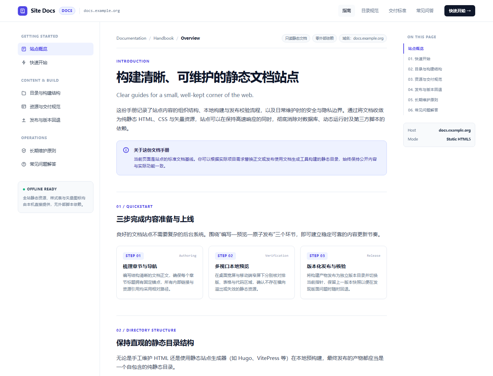
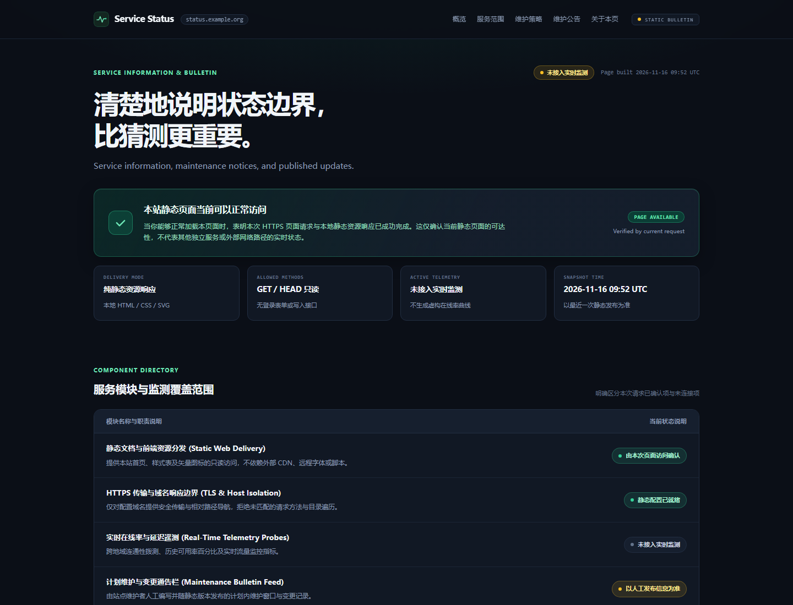
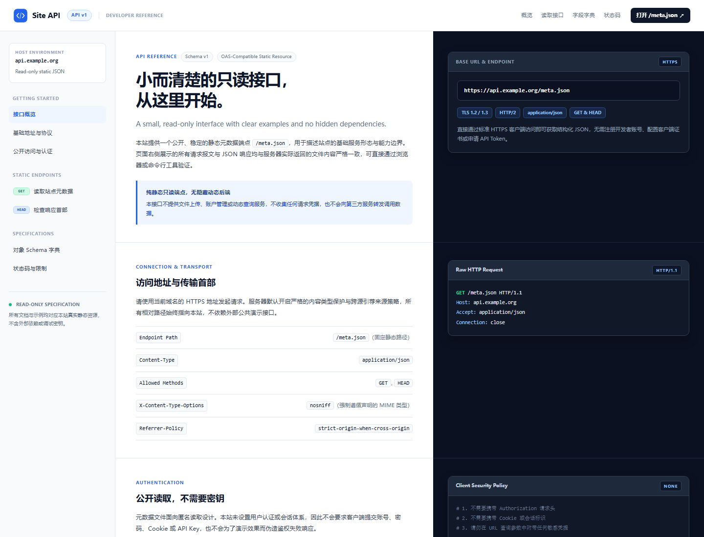

# ToastWeb

**一个不接管现有代理的轻量静态网站部署器。**

默认使用 **Nginx + HTTP-01 + Let's Encrypt/Certbot**：公网 TCP 80 默认仅提供证书验证，网站 HTTPS 只监听 `127.0.0.1:8443`，适合作为 REALITY 的本机 Target。

> **V0.3.2 为开发版本，新增功能仍须经过隔离 Linux CI 与部署验收；既有 Debian 13 试点使用 V0.3.1，仍须按环境验收。** 已验证真实域名签发、带部署 hook 的续期 dry-run 及后端 TLS 1.3/h2/MLKEM；这不等于已完成真实到期续签、生产 REALITY 切换或客户端验收。不要直接在唯一的生产入口上无备份执行。

## 设计边界

ToastWeb 会安装必要依赖、部署静态网站、申请证书、配置定时续期，并管理自己的服务和文件。

**不会自动修改：**

- Cloudflare 或其他服务商的 DNS；不需要 DNS API Token。
- Xray、x-ui、REALITY 参数、节点凭据、订阅或客户端选组。
- UFW、iptables、安全组、SSH 端口、BBR 或内核参数。
- 已存在的 Nginx 主配置、站点文件、acme.sh 任务。

它不保证网站不可识别，也不保证网站部署后代理一定可用。REALITY 的 Target/SNI 切换和客户端更新始终是独立步骤。

## 架构

```text
公网 TCP 80 ── ToastWeb 独立 Nginx ── HTTP-01 验证文件
                                      （其他 HTTP 路径返回 404）

公网 TCP 443 ── 已有 Xray / REALITY
                    ├─ 认证成功：原有代理
                    └─ 普通 HTTPS：127.0.0.1:8443 ── ToastWeb 静态网站
```

ToastWeb 使用独立的 `toastweb-nginx.service` 和 `/etc/toastweb/nginx.conf`，不把自己的站点塞进已有 Nginx 配置。端口 80 或后端端口已被其他服务使用时会停止，而不是替你停掉那个服务。

如果本次**首次安装**发行版 Nginx，会控制包安装阶段的自动启动，并禁用刚引入的默认 `nginx.service` 自启；已有服务不会被如此处理。专用续期定时器只更新本项目的证书，不依赖全局 Certbot 定时器。

### REALITY 依赖与维护窗口

当 REALITY 的 target 指向本项目时，Nginx 已不只是展示页：后端 TLS 故障会影响新建 REALITY 握手和普通 HTTPS 回落。已建立的代理连接不一定立即断开，不能把影响简单等同于“网站返回 404”。本机 HTTPS 正常也不证明公网 443、真实代理认证或客户端配置正常，仍需分别验收。

生成的独立 unit 使用 `Restart=on-failure`、2 秒重试间隔、60 秒内最多 5 次启动，并设置 30 秒启动超时。启动限流位于 `[Unit]`；达到限制后可能停留在 failed，不能代替告警。人工 `systemctl stop` 不会被自动拉起，已有管理员 drop-in 不会被改写。

重启、升级或卸载前，保留独立于该代理的 SSH/控制台、配置备份及入口回滚方案。必要的 Nginx restart 会产生短暂的新建连接窗口；不要为演练在唯一生产入口上直接注入崩溃。停用或移除网站前，应先人工协调仍引用它的 REALITY。修复失败原因后，可由管理员执行 `systemctl reset-failed toastweb-nginx.service`，再启动并验收；工具不会反复强制启动被停用的服务。

## 支持范围

- Debian 13 / Ubuntu 24.04，使用系统软件包和正在运行的 systemd。
- Python 3.10+；基础网络工具 `ip`、`ss` 应已存在（`iproute2` 包）。
- 一个域名、一个站点、一个回环 HTTPS 端口。
- 普通域名，不支持通配符或 IP 证书。
- 内置原创 **docs / status / api** 三套静态模板；保留旧版 notes 以兼容现有安装。
- 也可部署 Hugo/PaperMod、Hextra 等工具**已经生成的静态目录**。
- 不在 VPS 安装 Hugo、Node.js、Docker 或数据库。

若极简镜像缺少 Python 或 iproute2，请先通过系统包管理器安装。ToastWeb 不会在缺少解释器时下载并执行未知二进制。

## 三套内置模板

| 域名前缀 | 主题 | 风格与内容 |
|---|---|---|
| `docs.` | `docs` | 浅色文档站：左侧导航、正文、右侧本页目录 |
| `status.` | `status` | 深色状态说明页：组件卡片、维护公告，明确标注未接入实时监测 |
| `api.` | `api` | 三栏接口参考：接口目录、说明、深色请求/JSON 示例；提供真实只读 `/meta.json` |

新安装默认 `--theme auto`：按域名第一个标签匹配上述三种前缀，其他域名回退为 `docs`。可以用 `--theme docs`、`--theme status` 或 `--theme api` 覆盖选择。子域名命名不会带来已证实的抗识别优势。

**这三套是可选模板，不是自动创建三个域名或同时部署三个站点。** 当前依然一次管理一个域名单站点，DNS 由你另行配置。

已有安装重装时，`auto` 会保留原主题；旧版没有主题字段的站点按 `notes` 保留，不会因升级而更换页面。自定义内容也不会被静默替换。

**内置模板只适合作为起步和自检内容，正式节点建议发布自己的静态内容。** 默认公开页面不再展示部署器名称或管理命令，但共享的 HTML/CSS/图标仍可被关联；这不是去指纹或抗识别保证。升级不会擅自覆盖你已有的站点标题，可通过 `--title` 显式调整。

所有主题均为本地 HTML/CSS/SVG，无第三方字体、脚本、追踪或假登录表单。`status` 不编造在线率，`api` 不伪造认证接口；它展示的元数据是静态文件，不是实时健康探测。

### 预览

以下为真实浏览器渲染截图，使用示例域名，不包含生产配置：

#### docs



[查看 docs 窄屏预览](.github/previews/docs-mobile.png)

#### status



[查看 status 窄屏预览](.github/previews/status-mobile.png)

#### api



[查看 api 窄屏预览](.github/previews/api-mobile.png)

## 安装前必须完成

1. 将域名 A 记录指向 VPS 公网 IPv4。Cloudflare 记录设为 **DNS only / 灰云**。
2. 如果存在 AAAA，必须也正确指向该 VPS，并确认 IPv6 TCP 80 可达；不准备使用时先移除错误 AAAA。
3. 在系统防火墙和提供商安全组放行 **公网 TCP 80**。脚本不修改防火墙。
4. TCP 80 要在后续续期时持续可达，不能签完证书就关闭。
5. 检查旧 acme.sh、Certbot standalone、其他网站是否需要独占 80。
6. 保持已有代理和客户端配置不变，先完成网站独立验收。

DNS 检查要求系统解析出的全部 A/AAAA 都指向本机。NAT 环境可明确提供 `--expected-ip`：只有显式提供、且不是本机地址的连接建立失败会降为警告，以兼容不支持 NAT 回环的网络。本机/回环地址仍严格检查；连接成功后的 HTTP 错误、协议故障或验证 token 不匹配仍会终止安装。本机探测不等同于公网可达，最终仍须通过 CA 验证，不能借此绕过证书签发。

## 快速开始

先克隆并审阅代码，建议固定到已审阅的 tag/commit，**不要 `curl | sudo bash`**。

```bash
git clone https://github.com/MerryToast/ToastWeb.git
cd ToastWeb

# 只打印计划，不安装、不联网签证书，也不要求 root。
python3 toastweb.py plan --domain docs.example.org --email you@example.org

# 交互式安装：询问域名、证书联系邮箱、CA 条款及 TCP 80 可达性。
sudo bash install.sh
```

仓库已公开，可匿名拉取，不需要向 VPS 分发 GitHub Token 或部署密钥。

非交互式部署示例：

```bash
sudo bash install.sh \
  --domain docs.example.org \
  --theme docs \
  --email you@example.org \
  --title '我的文档' \
  --description '记录项目的使用方式与维护说明。' \
  --accept-tos \
  --confirm-port-80 \
  --non-interactive
```

`--accept-tos` 表示你已阅读并同意 [Let's Encrypt 订阅者协议](https://letsencrypt.org/repository/)。`--confirm-port-80` 是你的明确确认，**不会替你开放防火墙**。

检测到旧 ACME 自动化时，默认停止。人工确认验证方式和端口不会冲突后，才可额外添加：

```text
--allow-existing-acme
```

不会自动删除或禁用旧任务。已有自定义 `policy-rc.d` 时也会停止，不替换管理员策略。

### 可选：软件包升级后的运行时更新

**默认关闭。** 新版本安装时可显式增加 `--package-upgrade-restart`，允许相关二进制/库更新后短暂重启本项目的 Nginx：

```bash
sudo bash install.sh \
  --domain docs.example.org --email you@example.org \
  --accept-tos --confirm-port-80 --non-interactive \
  --package-upgrade-restart
```

重装请保留原有内容等参数；自定义站点仍须提供 `--content-dir`。未指定开关时保留原策略，旧 state 缺少此字段视为关闭。按原安装参数重装并改用 `--no-package-upgrade-restart` 可关闭：仅移除本项目拥有的 APT hook/oneshot unit，保留共享软件包及管理员配置。没有单独的卸载或证书删除操作。

启用后额外安装系统 `needrestart`，写入带所有权标记的 APT `DPkg::Post-Invoke` hook。hook 只异步调度静态 oneshot 服务，不等待重启，也不因调度失败阻止 APT；调度失败写入 syslog。任务最多约 15 分钟等待 APT/dpkg 记录锁；等待包管理器时**不持有本站操作锁**，取得本站锁后会再次检查，若包管理器开始工作则释放本站锁继续等待；检查和等待过程都不占用包管理器锁。

任务仅在 `needrestart -b -r l -l` 报告本服务需要更新、服务 active 且未 masked、管理员 `policy-rc.d` 允许时执行：配置校验 → `try-restart` → 新 master → 可信 TLS 1.3 / HTTPS HEAD → 再次检测。`-b` 是批处理，`-r l` 是 list-only，`-l` 仅检查库和已删除的可执行文件，不会重启任何服务。batch 名单遵循 `blacklist_rc`，但本工具不沿用 `override_rc` 的交互/默认勾选；重启授权来自用户显式启用本功能以及上述 active/unmasked/`policy-rc.d` 检查。配置无效时不停止原服务；并发停用不会被强制拉起；无关软件包更新不会无条件重启网站。

**reload 不等于二进制或共享库更新。** 续期加载证书仍用 reload；需要加载新程序/库时才走受控 restart。失败会保留非零状态和 journal，不自动降级软件包，不改 Xray、SSH 或整机自动更新策略；定时健康探针及可选通知见下文，默认不启用、不配置外部渠道。现有系统自己的 needrestart 策略可能另行重启服务，本集成不覆盖它；batch 名单会受 `blacklist_rc` 等过滤配置影响，但本独立 opt-in 不使用 `override_rc` 授权，也不是独立完备的补丁审计。

```bash
sudo toastweb package-refresh  # 重新检查；未启用策略时不重启
systemctl status toastweb-package-refresh.service
journalctl -u toastweb-package-refresh.service -n 50 --no-pager
```

仅适用于 APT 安装的二进制/已加载库；手工替换程序、长时间 APT 操作导致等待超时，或刷新期间发生另一轮升级，需检查日志后重试。首次启用/重装后也会异步检查一次。此功能不修改 DNS、防火墙、证书、订阅或 REALITY 参数。

## 安装后验收

```bash
sudo toastweb status
sudo toastweb doctor
sudo toastweb renew-test
```

- `doctor`：只读检查配置、有效 systemd 重启/限流策略、FD 预算、续期 timer、实际监听归属与回环范围、磁盘和在服证书期限/叶指纹一致性、可信 TLS 1.3/h2 和独立 HTTPS HEAD 200。
- `renew-test`：通过 CA 测试环境演练 HTTP-01 续期，不替换现有正式证书；默认不执行部署 hook。
- 再人工验证未知 SNI、正确 SNI 配错误 Host 均被拒绝，目录跳转不带出后端端口；检查内容、监听范围及 MLKEM 是否满足要求。

`doctor --json` 输出结构化报告；退出码 `0` 表示本地必要检查通过（可含警告），`1` 表示错误，`2` 表示必要检查未能确认。证书临期默认 20 天，可用 `--warn-cert-days 10` 调整，不会把缺工具/权限等未知结果当作通过。监听检查依据 `ss` 与本服务 MainPID，不以回环连接成功代替仅回环证明。

```bash
sudo toastweb doctor --json
sudo toastweb doctor --dns-checks --warn-cert-days 20
```

DNS 检查需显式请求，仅读取固定 HTTPS 解析器 `dns.google`：CAA 按父域继承查找，DNSSEC 以验证解析器 AD 位为证据，不自行完成整条链验证。缺少 CAA/DNSSEC 不是启动错误，查询失败保留 unknown；不会写 DNS。访问日志仅统计有界尾部的来源计数，不输出请求行/URL。全回环在 `xver=0` 时正常，公网 HTTP/ACME 流量也可产生非回环记录，不据此判断 HTTPS 边界。

**此时浏览器访问公网 443 可能仍显示旧目标站点或握手失败，这是尚未切换 REALITY 的预期。** 可以先通过 SSH 隧道检查后端：

```bash
# 在你的电脑上执行；替换 SSH 用户、端口及 VPS 地址。
ssh -p 11760 -L 18443:127.0.0.1:8443 user@VPS_IP

# 另一个本地终端，通过正确 SNI 测试，不跳过证书校验。
curl --resolve notes.example.org:18443:127.0.0.1 https://notes.example.org:18443/
```

正式切换时，另行持久化更新 x-ui/Xray：

```json
{
  "target": "127.0.0.1:8443",
  "serverNames": ["notes.example.org"],
  "xver": 0
}
```

同步更新所有相关客户端/订阅的 SNI，保留原目标的回滚配置；不要丢失已有 sockopt。ToastWeb 不执行这一步。

### 可选的 HTTP→HTTPS 跳转

默认维持 80 普通路径返回 404，不能把回环 TLS 就绪当成公网 443 已经切换。**完成入口与客户端切换，并从外网核对该域名的可信证书和实际页面内容后**，才可主动开启：

```bash
sudo toastweb http-redirect enable --confirm-public-https
# 需要回滚入口前，先关闭跳转。
sudo toastweb http-redirect disable
```

确认参数仅表示你的人工确认，不是程序完成了公网验证。跳转固定到已配置域名，不信任任意 Host；HTTP-01 验证路径仍直接服务文件。该设置会在重装中保留，开启/关闭失败会尝试恢复原配置。

## 可选：本地后端探针与告警

**默认关闭，旧 state 缺少设置也按关闭处理。** 安装新版程序后可单独启用，不需要重装网站或重签证书：

```bash
sudo toastweb monitor enable --interval 120 --failures 3 --warn-cert-days 20
sudo toastweb monitor status
sudo toastweb monitor check --json
journalctl -u toastweb-health.service -n 30 --no-pager
sudo toastweb monitor disable
```

`interval` 为每次探针退出后等待的秒数（60–3600），不是精确日历调度；`failures` 为连续采样阈值（1–10）。timer 初次约 10 秒后运行。探针复用本地诊断，不查询公共 DNS；必要检查失败、结果未知或证书临期持续达到阈值后记录一次事件，相同问题去重，恢复后记录恢复事件。通知失败不标作送达，同一事件至少间隔 300 秒再尝试；中断/超时下不保证外部渠道恰好投递一次。

默认渠道是 **journal/命令输出**，没有自动接入邮件、Telegram 或其他平台。需要外部发送时，由你审阅并配置一个可信通知程序：

```bash
# 自行准备并审阅这个脚本；它从 stdin 接收事件 JSON，退出 0 表示已处理。
sudo install -o root -g root -m 700 /path/to/reviewed-notify /etc/toastweb/notify.sh
sudo toastweb monitor enable --notify-command /etc/toastweb/notify.sh
# 清除外部渠道，恢复仅 journal：
sudo toastweb monitor enable --clear-notifier
```

通知程序必须是绝对路径、私有可执行常规文件（例如 root:root 0700），自身和所有父目录均 root 拥有、不可被组/其他用户写入，且不得为符号链接；不能放在 `/root` 或 `/home`，因为探针启用了 ProtectHome。程序以单独 argv 执行，**不经 shell**；只接收事件种类、公开域名/端口、时间和检查 ID 等安全摘要，时间为 Unix 秒。stdout/stderr 丢弃，10 秒超时，不能把通知成功等同于接收方已阅读。渠道凭据应在公开站点之外以 root 0600 存放，不能放进命令行、网页或报告。

启用/关闭只管理本项目的探针 unit/timer 和设置，不会启动、重启或修复 Nginx/Xray，也不会删通知脚本、证书或未知文件。设置变更有所有权检查与失败恢复；重装保留策略。运行记录保存在私有 `health-state.json`，不被内容回滚覆盖。`monitor status` 展示配置、timer/probe 状态与上次采样；oneshot 在两次采样之间为 inactive 属正常。

**这是同机后端监控，不是公网或代理端到端监控。** 它不能在整台 VPS 宕机时通知，也不能证明公网 TCP 80/443、CA 真实续签、MLKEM 或 REALITY 认证健康；仍需独立外部监控和人工验收。`renew-test` 的默认部署 hook 行为未改变，不能用普通 dry-run 替代部署链路演练。

## 内容更新和回滚

模板是原创轻量静态页面，不包含登录表单、广告、第三方字体或统计脚本。初始说明不是虚构的个人文章，请按实际情况替换。可显式切换主题，随后回滚会同时恢复内容及主题信息：

```bash
sudo toastweb update --theme api
sudo toastweb rollback
```

切换主题不会修改域名、证书或 DNS；`docs.` 也可以选择 `api` 风格。

```bash
# Hugo 等工具在电脑/CI 构建，将 public/ 上传到 VPS 后发布。
sudo toastweb update --content-dir /path/to/public

# 返回前一个内容版本；再次执行可切换回另一个版本。
sudo toastweb rollback
```

静态目录必须有 `index.html`；拒绝隐藏文件、符号链接、特殊文件及超过安全限额的目录，避免把 `.env` 等内容发布出去。`--theme` 与 `--content-dir` 不能同时指定。自定义内容发布后，自动更新/重装必须继续提供 `--content-dir`；只有显式指定 `--theme` 才会切换回内置模板。

在源码目录执行 `python3 toastweb.py update` 可发布源码中的当前主题，省略 `--theme` 时保留已有主题。项目程序升级需要先审阅 `git pull` 的变更，再按原参数重新执行安装；域名/端口迁移仍不自动进行。

## 历史版本与连接预算

成功安装、内容更新/回滚或跳转策略变更后，在同一操作锁内清理**已登记所有权**的历史记录。默认保留最近 5 个内容版本及 5 份配置备份；当前版本、前一版本、当前链接和保留备份引用的版本额外保护，因此实际数量可能更多。失败事务不会触发清理；发布已成功而清理失败时仅警告，不回滚工作中的站点。

旧版未登记的目录、无法确认归属的记录和顶层符号链接不自动删除；可识别的旧备份引用也会保护对应内容。待删除目录中存在嵌套符号链接时停止清理，交由人工检查。证书、ACME 账户、其他项目及共享依赖不属于清理范围。该机制不是磁盘硬配额，也不取代异机备份。

```bash
# 默认仅预览；--apply 才删除，删除不可撤销。
sudo toastweb prune
sudo toastweb prune --keep-releases 5 --keep-backups 5 --apply
```

安装参数 `--keep-releases N --keep-backups N` 可持久化保留策略（各 1–50）；重装未指定时保留已有设置。`prune` 的同名参数只用于本次操作。

`worker_connections` 默认仍为 **512**，不把提高参数当成已经解决瓶颈。确有并发需求时，可在安装/重装命令中加入 `--worker-connections 2048`（允许 64–8192）。程序同步设置独立服务的 `LimitNOFILE` 与 Nginx worker 文件描述符上限为 `max(4096, 4 × worker_connections)`；`doctor` 检查服务配置预算。提高上限仍需评估系统硬限制、内存、实际连接/文件占用和压力测试，当前没有生产容量或吞吐提升结论。

## 文件和服务

| 路径/名称 | 用途 |
|---|---|
| `/etc/toastweb/nginx.conf` | 独立 Nginx 配置 |
| `/etc/toastweb/site.json` | 本机状态，0600；不是可执行 shell 配置 |
| `/usr/local/lib/toastweb` | 安装后的程序及默认模板 |
| `/usr/local/bin/toastweb` | 命令入口 |
| `/srv/toastweb/releases/*` | 静态内容版本 |
| `/srv/toastweb/current` | 当前版本符号链接 |
| `/var/lib/toastweb/acme` | HTTP-01 验证目录 |
| `/var/lib/toastweb/backups` | 配置备份及引用清单，0700 |
| `/var/lib/toastweb/release-records` | 私有内容所有权登记，0700；不放在公开站点中 |
| `/var/log/toastweb` | 网站日志；logrotate 保留 7 份 |
| `/etc/letsencrypt/live/toastweb-<domain>` | Certbot 管理的证书 |
| `toastweb-nginx.service` | 网站服务，不是发行版 nginx.service |
| `toastweb-renew.timer` / `.service` | 每日两次检查本项目证书续期 |
| `/etc/apt/apt.conf.d/99-toastweb-package-refresh` | 可选、默认关闭的升级后调度 hook |
| `toastweb-package-refresh.service` | 可选的独立 oneshot；不自行启动被停用的网站 |
| `toastweb-health.service` / `.timer` | 可选本地诊断探针，默认关闭，不自愈网站 |
| `/var/lib/toastweb/health-state.json` | 私有告警计数/去重状态，0600，不放进公开内容 |
| `/run/toastweb-health/monitor.lock` | 私有运行目录中的独立探针锁 |

续期成功后，限定证书 lineage 的部署 hook 先检查配置，再平滑加载 **ToastWeb 的 Nginx**，不会重启 Xray。

`xver=0` 时，回落网站日志中的来源通常是回环地址，不可据此宣称实现按真实访客 IP 限流。真实 IP/PROXY protocol 支持留给后续明确设计。

## 失败与恢复

- 发行版依赖安装、CA 账户和已签发的证书不是可事务回滚的资源。
- 站点变更失败时，尽力恢复本项目配置、应用文件、服务状态及内容指针；保留备份和未激活内容版本。
- 不为恢复而重启或停止 Xray、x-ui、现有 Nginx、SSH 等无关服务。
- APT 中断可能需要管理员修复；不会自动卸载系统软件包。
- 包安装期间会临时创建 `/usr/sbin/policy-rc.d` 阻止服务自动启动/重启，并在正常异常退出时清理。断电或 SIGKILL 可能留下它：管理员应核实其包含 `Temporary ToastWeb package-install guard` 标记后再清理，不能盲目删除已有管理员策略。
- 续签失败需检查 journal 和 DNS/80/CAA/CA 限流等原因。创建 timer 不代表永远续签成功。
- 历史清理只管理本项目已登记的内容/配置备份，不提供自动卸载。移除网站仍需按文件清单人工审查，先处理仍在引用该网站的 REALITY，不能误删共享依赖或证书。

## 开发与测试

Python 程序仅使用标准库；可选的软件包运行时检测依赖发行版 `needrestart`：

```bash
python3 -m unittest discover -s tests -v
bash -n install.sh

# 可选：Linux 测试机安装 Nginx/OpenSSL，以及开发依赖后运行真实进程测试。
python3 -m venv /tmp/toastweb-tests
/tmp/toastweb-tests/bin/pip install -r requirements-dev.txt
TOASTWEB_LIVE_NGINX=1 /tmp/toastweb-tests/bin/python -m unittest discover -s tests -v
sudo env TOASTWEB_LIVE_NGINX=1 /tmp/toastweb-tests/bin/python -m unittest discover -s tests -v
```

`TOASTWEB_LIVE_SYSTEMD=1` 仅供可丢弃的 root Linux CI/测试机：会创建随机名 `toastweb-ci-*.service`，测试数据和可执行副本放在 `/var/lib/toastweb-ci-*-fixture-*`，PID 目录仍在 `/run/toastweb-ci-*`；只用回环高端口验证真实重启、限流及可执行文件替换，并清理自己的文件和 unit。**不要在生产 VPS 开启此测试模式。** 新增 Linux/systemd 用例尚待 CI 执行，不把 Windows 的跳过计为通过。

开发者如需重建预览截图，需要在电脑上准备 Node 22+ 和 Chromium/Chrome/Edge，然后运行：

```bash
python3 tools/preview_themes.py
```

该工具使用全新浏览器配置、回环临时站点及 CDP 的精确视口模拟，检查 1440px / 390px 视口没有文档级横向溢出。它不属于 VPS 安装依赖，不使用你的浏览器登录状态。

普通 Nginx 集成测试仅使用临时目录、高位回环端口和测试自签证书，不申请真实证书、不更改 DNS 或 systemd；显式启用的独立 systemd 测试有前述一次性环境限制。GitHub Actions 在 Ubuntu 24.04 上分别以非 root 和 root 运行完整测试，后者核对 Nginx worker 实际降权为 www-data；`h2` 包仅用于开发测试，不是 VPS 依赖。Debian 13 独立网站试点已另行验收，CI 不包含真实 CA 或生产变更。验证范围与历史记录见 [TESTING.md](TESTING.md)。

## 安全与许可

不提交证书私钥、API Token、GitHub 凭据、代理凭据或真实生产配置。公开项目不等于公开本机状态。发布安全问题时不要粘贴秘密或完整敏感日志。

MIT License，见 [LICENSE](LICENSE)。
