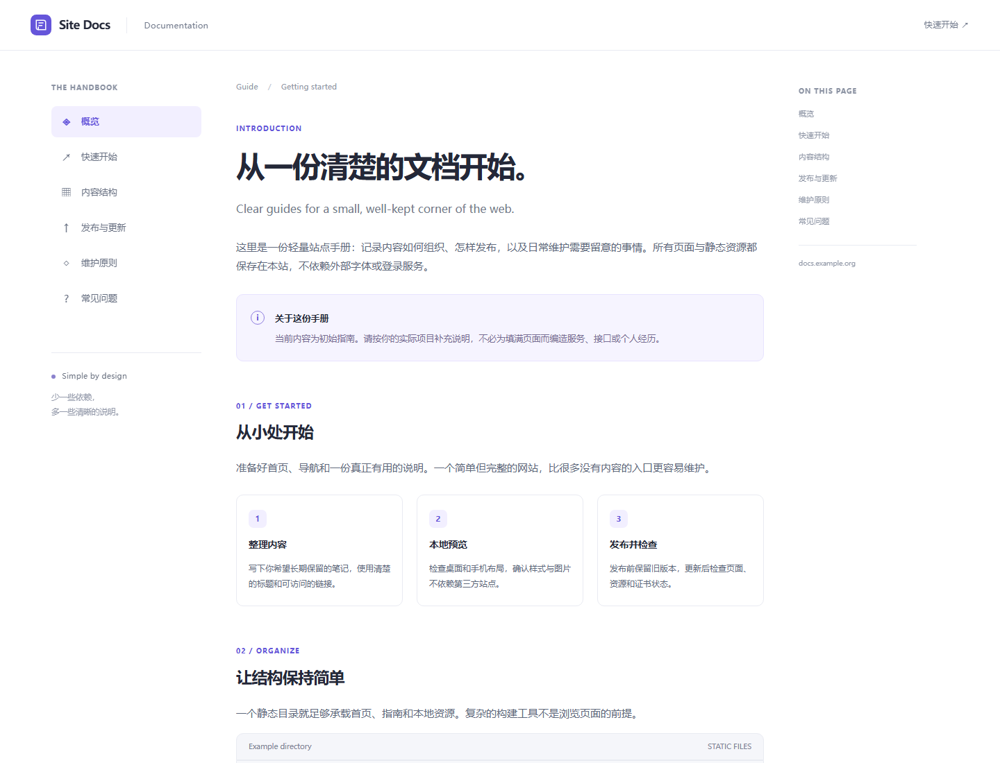
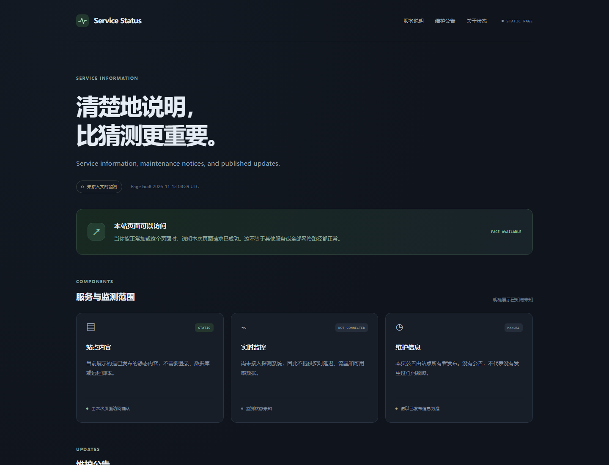
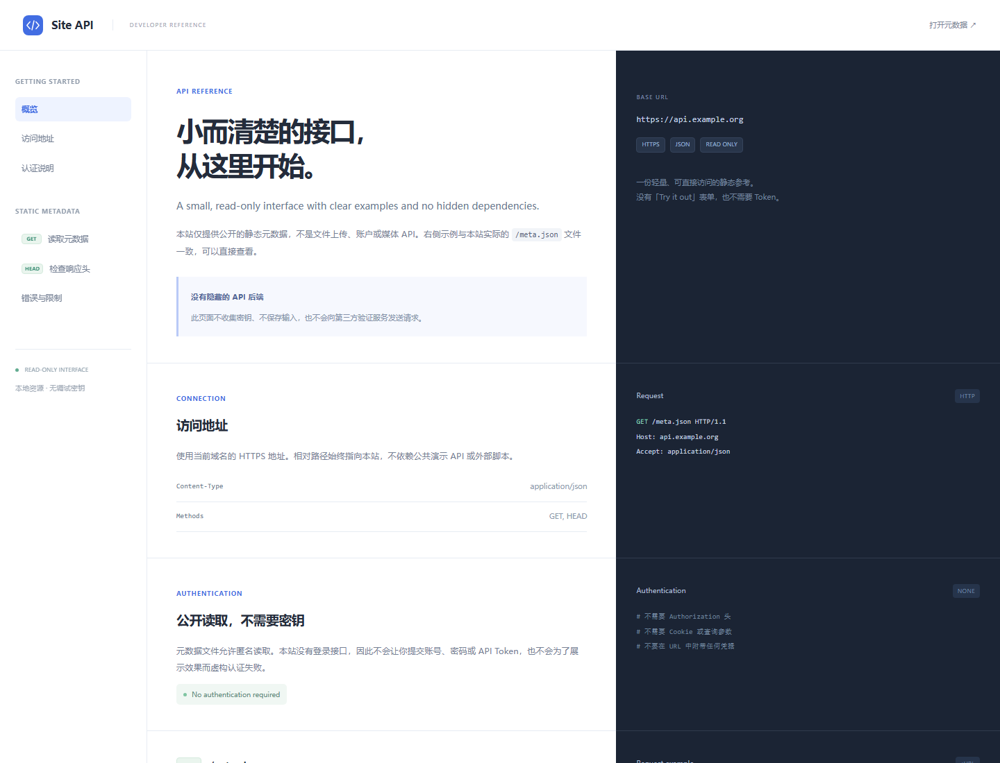

# ToastWeb

**一个不接管现有代理的轻量静态网站部署器。**

默认使用 **Nginx + HTTP-01 + Let's Encrypt/Certbot**：公网 TCP 80 仅提供证书验证，网站 HTTPS 只监听 `127.0.0.1:8443`，适合作为 REALITY 的本机 Target。

> **V0.2 仍需 VPS 试点验收。** 仓库包含自动测试和 Linux Nginx 集成测试，但这不等于已经完成真实域名的 ACME 签发、续签或生产 REALITY 验收。不要直接在唯一的生产入口上无备份执行。

## 设计边界

ToastWeb 会安装必要依赖、部署静态网站、申请证书、配置定时续期，并管理自己的服务和文件。

**不会自动修改：**

- Cloudflare 或其他服务商的 DNS；不需要 DNS API Token。
- Xray、x-ui、REALITY 参数、节点凭据、订阅或客户端选组。
- UFW、iptables、安全组、SSH 端口、BBR 或内核参数。
- 已存在的 Nginx 主配置、站点文件、acme.sh 任务。

它不保证网站不可识别，也不保证网站部署后代理一定可用。REALITY 的 Target/SNI 切换和客户端更新始终是独立步骤。

## 架构

```text
公网 TCP 80 ── ToastWeb 独立 Nginx ── HTTP-01 验证文件
                                      （其他 HTTP 路径返回 404）

公网 TCP 443 ── 已有 Xray / REALITY
                    ├─ 认证成功：原有代理
                    └─ 普通 HTTPS：127.0.0.1:8443 ── ToastWeb 静态网站
```

ToastWeb 使用独立的 `toastweb-nginx.service` 和 `/etc/toastweb/nginx.conf`，不把自己的站点塞进已有 Nginx 配置。端口 80 或后端端口已被其他服务使用时会停止，而不是替你停掉那个服务。

如果本次**首次安装**发行版 Nginx，会控制包安装阶段的自动启动，并禁用刚引入的默认 `nginx.service` 自启；已有服务不会被如此处理。专用续期定时器只更新本项目的证书，不依赖全局 Certbot 定时器。

## 支持范围

- Debian 13 / Ubuntu 24.04，使用系统软件包和正在运行的 systemd。
- Python 3.10+；基础网络工具 `ip`、`ss` 应已存在（`iproute2` 包）。
- 一个域名、一个站点、一个回环 HTTPS 端口。
- 普通域名，不支持通配符或 IP 证书。
- 内置原创 **docs / status / api** 三套静态模板；保留旧版 notes 以兼容现有安装。
- 也可部署 Hugo/PaperMod、Hextra 等工具**已经生成的静态目录**。
- 不在 VPS 安装 Hugo、Node.js、Docker 或数据库。

若极简镜像缺少 Python 或 iproute2，请先通过系统包管理器安装。ToastWeb 不会在缺少解释器时下载并执行未知二进制。

## 三套内置模板

| 域名前缀 | 主题 | 风格与内容 |
|---|---|---|
| `docs.` | `docs` | 浅色文档站：左侧导航、正文、右侧本页目录 |
| `status.` | `status` | 深色状态说明页：组件卡片、维护公告，明确标注未接入实时监测 |
| `api.` | `api` | 三栏接口参考：接口目录、说明、深色请求/JSON 示例；提供真实只读 `/meta.json` |

新安装默认 `--theme auto`：按域名第一个标签匹配上述三种前缀，其他域名回退为 `docs`。可以用 `--theme docs`、`--theme status` 或 `--theme api` 覆盖选择。子域名命名不会带来已证实的抗识别优势。

**这三套是可选模板，不是自动创建三个域名或同时部署三个站点。** 当前依然一次管理一个域名单站点，DNS 由你另行配置。

已有安装重装时，`auto` 会保留原主题；旧版没有主题字段的站点按 `notes` 保留，不会因升级而更换页面。自定义内容也不会被静默替换。

所有主题均为本地 HTML/CSS/SVG，无第三方字体、脚本、追踪或假登录表单。`status` 不编造在线率，`api` 不伪造认证接口；它展示的元数据是静态文件，不是实时健康探测。

### 预览

以下为真实浏览器渲染截图，使用示例域名，不包含生产配置：

#### docs



[查看 docs 窄屏预览](.github/previews/docs-mobile.png)

#### status



[查看 status 窄屏预览](.github/previews/status-mobile.png)

#### api



[查看 api 窄屏预览](.github/previews/api-mobile.png)

## 安装前必须完成

1. 将域名 A 记录指向 VPS 公网 IPv4。Cloudflare 记录设为 **DNS only / 灰云**。
2. 如果存在 AAAA，必须也正确指向该 VPS，并确认 IPv6 TCP 80 可达；不准备使用时先移除错误 AAAA。
3. 在系统防火墙和提供商安全组放行 **公网 TCP 80**。脚本不修改防火墙。
4. TCP 80 要在后续续期时持续可达，不能签完证书就关闭。
5. 检查旧 acme.sh、Certbot standalone、其他网站是否需要独占 80。
6. 保持已有代理和客户端配置不变，先完成网站独立验收。

DNS 检查要求系统解析出的全部 A/AAAA 都指向本机。NAT 环境可明确提供 `--expected-ip`。本机 HTTP 探测不等同于从公网成功访问，最终仍由 CA 验证。

## 快速开始

先克隆并审阅代码，建议固定到已审阅的 tag/commit，**不要 `curl | sudo bash`**。

```bash
git clone https://github.com/MerryToast/ToastWeb.git
cd ToastWeb

# 只打印计划，不安装、不联网签证书，也不要求 root。
python3 toastweb.py plan --domain docs.example.org --email you@example.org

# 交互式安装：询问域名、证书联系邮箱、CA 条款及 TCP 80 可达性。
sudo bash install.sh
```

如果仓库仍为私有，需要先为 VPS 配置只读 GitHub 凭据/部署密钥，或通过可信渠道上传项目；不要把 GitHub Token 写进 clone URL。改成公开仓库后可匿名拉取。

非交互式部署示例：

```bash
sudo bash install.sh \
  --domain docs.example.org \
  --theme docs \
  --email you@example.org \
  --title '我的文档' \
  --description '记录项目的使用方式与维护说明。' \
  --accept-tos \
  --confirm-port-80 \
  --non-interactive
```

`--accept-tos` 表示你已阅读并同意 [Let's Encrypt 订阅者协议](https://letsencrypt.org/repository/)。`--confirm-port-80` 是你的明确确认，**不会替你开放防火墙**。

检测到旧 ACME 自动化时，默认停止。人工确认验证方式和端口不会冲突后，才可额外添加：

```text
--allow-existing-acme
```

不会自动删除或禁用旧任务。已有自定义 `policy-rc.d` 时也会停止，不替换管理员策略。

## 安装后验收

```bash
sudo toastweb status
sudo toastweb doctor
sudo toastweb renew-test
```

- `doctor`：检查配置、服务、续期定时器、证书有效性及可信 TLS 1.3 + h2 握手。
- `renew-test`：通过 CA 测试环境演练 HTTP-01 续期，不替换现有正式证书；默认不执行部署 hook。
- 再人工验证未知 SNI 被拒绝、网站内容正常、端口只按计划暴露，以及 MLKEM 是否满足要求。

**此时浏览器访问公网 443 可能仍显示旧目标站点或握手失败，这是尚未切换 REALITY 的预期。** 可以先通过 SSH 隧道检查后端：

```bash
# 在你的电脑上执行；替换 SSH 用户、端口及 VPS 地址。
ssh -p 11760 -L 18443:127.0.0.1:8443 user@VPS_IP

# 另一个本地终端，通过正确 SNI 测试，不跳过证书校验。
curl --resolve notes.example.org:18443:127.0.0.1 https://notes.example.org:18443/
```

正式切换时，另行持久化更新 x-ui/Xray：

```json
{
  "target": "127.0.0.1:8443",
  "serverNames": ["notes.example.org"],
  "xver": 0
}
```

同步更新所有相关客户端/订阅的 SNI，保留原目标的回滚配置；不要丢失已有 sockopt。ToastWeb 不执行这一步。

## 内容更新和回滚

模板是原创轻量静态页面，不包含登录表单、广告、第三方字体或统计脚本。初始说明不是虚构的个人文章，请按实际情况替换。可显式切换主题，随后回滚会同时恢复内容及主题信息：

```bash
sudo toastweb update --theme api
sudo toastweb rollback
```

切换主题不会修改域名、证书或 DNS；`docs.` 也可以选择 `api` 风格。

```bash
# Hugo 等工具在电脑/CI 构建，将 public/ 上传到 VPS 后发布。
sudo toastweb update --content-dir /path/to/public

# 返回前一个内容版本；再次执行可切换回另一个版本。
sudo toastweb rollback
```

静态目录必须有 `index.html`；拒绝隐藏文件、符号链接、特殊文件及超过安全限额的目录，避免把 `.env` 等内容发布出去。`--theme` 与 `--content-dir` 不能同时指定。自定义内容发布后，自动更新/重装必须继续提供 `--content-dir`；只有显式指定 `--theme` 才会切换回内置模板。

在源码目录执行 `python3 toastweb.py update` 可发布源码中的当前主题，省略 `--theme` 时保留已有主题。项目程序升级需要先审阅 `git pull` 的变更，再按原参数重新执行安装；域名/端口迁移仍不自动进行。

## 文件和服务

| 路径/名称 | 用途 |
|---|---|
| `/etc/toastweb/nginx.conf` | 独立 Nginx 配置 |
| `/etc/toastweb/site.json` | 本机状态，0600；不是可执行 shell 配置 |
| `/usr/local/lib/toastweb` | 安装后的程序及默认模板 |
| `/usr/local/bin/toastweb` | 命令入口 |
| `/srv/toastweb/releases/*` | 静态内容版本 |
| `/srv/toastweb/current` | 当前版本符号链接 |
| `/var/lib/toastweb/acme` | HTTP-01 验证目录 |
| `/var/lib/toastweb/backups` | 配置备份，0700 |
| `/var/log/toastweb` | 网站日志；logrotate 保留 7 份 |
| `/etc/letsencrypt/live/toastweb-<domain>` | Certbot 管理的证书 |
| `toastweb-nginx.service` | 网站服务，不是发行版 nginx.service |
| `toastweb-renew.timer` / `.service` | 每日两次检查本项目证书续期 |

续期成功后，限定证书 lineage 的部署 hook 先检查配置，再平滑加载 **ToastWeb 的 Nginx**，不会重启 Xray。

`xver=0` 时，回落网站日志中的来源通常是回环地址，不可据此宣称实现按真实访客 IP 限流。真实 IP/PROXY protocol 支持留给后续明确设计。

## 失败与恢复

- 发行版依赖安装、CA 账户和已签发的证书不是可事务回滚的资源。
- 站点变更失败时，尽力恢复本项目配置、应用文件、服务状态及内容指针；保留备份和未激活内容版本。
- 不为恢复而重启或停止 Xray、x-ui、现有 Nginx、SSH 等无关服务。
- APT 中断可能需要管理员修复；不会自动卸载系统软件包。
- 包安装期间会临时创建 `/usr/sbin/policy-rc.d` 阻止服务自动启动/重启，并在正常异常退出时清理。断电或 SIGKILL 可能留下它：管理员应核实其包含 `Temporary ToastWeb package-install guard` 标记后再清理，不能盲目删除已有管理员策略。
- 续签失败需检查 journal 和 DNS/80/CAA/CA 限流等原因。创建 timer 不代表永远续签成功。
- V1 不提供自动清理/卸载命令，避免误删共享依赖或仍在使用的证书。请按文件清单人工审查清理，先处理仍在引用该网站的 REALITY。

## 开发与测试

仅使用 Python 标准库运行项目：

```bash
python3 -m unittest discover -s tests -v
bash -n install.sh

# 可选：Linux 测试机已安装 Nginx/OpenSSL 时开启真实进程集成测试。
TOASTWEB_LIVE_NGINX=1 python3 -m unittest discover -s tests -v
```

开发者如需重建预览截图，需要在电脑上准备 Node 22+ 和 Chromium/Chrome/Edge，然后运行：

```bash
python3 tools/preview_themes.py
```

该工具使用全新浏览器配置、回环临时站点及 CDP 的精确视口模拟，检查 1440px / 390px 视口没有文档级横向溢出。它不属于 VPS 安装依赖，不使用你的浏览器登录状态。

集成测试仅使用临时目录、高位回环端口和测试自签证书，不申请真实证书、不更改 DNS 或 systemd。GitHub Actions 在 Ubuntu 24.04 上执行这些测试；Debian 13 的首次真实 VPS 试点仍需单独验收。初版测试记录见 [TESTING.md](TESTING.md)。

## 安全与许可

不提交证书私钥、API Token、GitHub 凭据、代理凭据或真实生产配置。公开项目不等于公开本机状态。发布安全问题时不要粘贴秘密或完整敏感日志。

MIT License，见 [LICENSE](LICENSE)。
